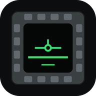

<p align="center"></p>

<h1 align="center">DCS Tablette</h1>

<p align="center">DCS World's cockpit displays on a tablet or phone, with their buttons under your finger.</p>

<p align="center">
<a href="https://github.com/led5014/dcs-tablette/releases/latest"></a>
<a href="https://github.com/led5014/dcs-tablette/releases"></a>
<a href="LICENSE"></a>
<a href="https://github.com/led5014/dcs-tablette/actions/workflows/tests.yml"></a>
<a href="https://led5014.github.io/dcs-tablette/en/"></a>
<a href="https://discord.gg/4KJYjt7pbc"></a>
</p>

<p align="center"><strong><a href="https://github.com/led5014/dcs-tablette/releases/latest">Download the latest release</a></strong> · <a href="https://led5014.github.io/dcs-tablette/en/">Website</a> · <a href="docs/guide.en.md">Full guide</a> · <a href="README.md">Français</a></p>

## What it does

- **Live displays**: DDIs, MFDs, MPDs mirrored from DCS, with the buttons
  around their frame. A button stays pressed in the cockpit for as long as
  your finger stays down.
- **Redrawn panels**: the Hornet's UFC, IFEI, standby instruments and
  warning lights; the F-16's ICP and DED.
- **Instruments for any aircraft**: airspeed, attitude, altimeter, turn and
  slip, heading, vertical speed, G, RPM, in the cockpit's own units. Enough
  to keep your eyes outside, warbirds included.
- **Kneeboard**: the mission, module and map pages and your own, plus the
  DCS kneeboard, live.
- **Per-display settings**: brightness, contrast, sharpness, resolution,
  filters (auto levels, night, amber…).
- **Tablet, phone or PC**: the page follows the aircraft you fly and only
  offers the layouts that stay comfortable to touch on the screen in use.

The server runs on the PC, and the tablet connects to it over your home
Wi-Fi. No Python to install, nothing over the internet in flight.

## What you need

- A Windows PC with DCS World.
- A tablet or phone on the same Wi-Fi: an iPad on iPadOS 13 or newer (iPad
  Air 2, iPad mini 4, iPad 5th generation and later), Android, or the browser
  of another PC.

## Install

1. Download `DCS-Tablette-x.y.z.zip` from the
   [latest release](https://github.com/led5014/dcs-tablette/releases/latest).
2. Extract it anywhere, then double-click **`Installer.bat`**. If Windows
   shows "Windows protected your PC": *More info* → *Run anyway* (the
   executable isn't signed; it is built from this repository).
3. Answer the window's questions. It installs and places a virtual display,
   where DCS draws the cockpit displays, installs the scripts in DCS, sets
   DCS to windowed and adds a **DCS Tablette** shortcut to the desktop. If a
   step fails, it says which one and what to do.

Each step, what it changes and how to do it by hand:
[guide, Installation](docs/guide.en.md#installation).

**Updating: nothing to do.** DCS Tablette updates itself at launch (verified
download, settings kept).
**Uninstall**: *Settings → Apps → Installed apps → DCS Tablette*.

## In flight

1. Launch **DCS Tablette** (desktop or Start menu): the window shows the
   address to open on the tablet (`http://192.168.x.x:8320`). On first
   launch, allow the program on **private** networks.
2. Open the address on the tablet, then add it to the home screen (Safari:
   *Share* → *Add to Home Screen*; Chrome: ⋮ → *Add to Home screen*).
3. Start DCS and a mission: the page builds itself for the aircraft you fly.

## Aircraft

| Aircraft | Displays + buttons | Also |
|---|---|---|
| F/A-18C Hornet | Left DDI, right DDI, AMPCD | touch UFC, IFEI, standby instruments, warning lights |
| F-16C Viper | Left MFD, right MFD | touch ICP, DED |
| AH-64D Apache | Left MPD, right MPD (+ FCR, WPN, TSD…), TEDAC (display only) | Pilot / CPG seat |
| OH-58D Kiowa | Left MFD, right MFD | — |
| A-10C / A-10C II | Left MFCD, right MFCD | — |
| AV-8B Harrier | Left MPCD, right MPCD | — |
| F-15E Strike Eagle | Left MPD, right MPD, MPCD (front seat) | — |
| JF-17 Thunder | Left, center and right MFCD (portrait, 26 buttons) | — |
| Ka-50 Black Shark II / III | Shkval (display only), ABRIS and its 5 buttons | — |
| C-130J-30 Super Hercules | Left, center and right HDD (display only; pages picked on the cockpit AMUs) | kneeboard |
| MiG-29A Fulcrum | HDD, the HUD repeater (TACT / DUBL switch) | HDD + instruments side by side, kneeboard |
| Warbirds: P-51D, TF-51D, P-47D, F4U-1D, Spitfire IX, Mosquito, Bf 109 K-4, Fw 190 A-8 / D-9, I-16, Yak-52 | — (round-gauge cockpits) | instruments in their own units, kneeboard |
| Korea: F-86F, MiG-15bis | — | instruments, kneeboard |
| F-14, F-4E, Mirage 2000C, Mirage F1, F-5E, MiG-21bis, MiG-19P, AJS-37, L-39, C-101, MB-339, FC3 | — | instruments, kneeboard |
| CH-47F, Mi-8MTV2, Mi-24P, UH-1H, SA342 | — | helicopter instruments, kneeboard |

Any other aircraft gets the basic instruments and the kneeboard. Buttons on
the F-16C, OH-58D, AV-8B, F-15E, JF-17 and Ka-50 still need confirming in
flight: feedback is welcome. Details per aircraft:
[guide, Aircraft](docs/guide.en.md#aircraft).

## Multiplayer

DCS Tablette only writes to `Saved Games\DCS`, never to the DCS install
folder: the multiplayer integrity check is not affected. The tablet script
inside DCS only accepts commands for the buttons shown (an allowlist per
aircraft) and releases any button held for more than 5 seconds. The files it
touches: [guide, What the installer changes](docs/guide.en.md#what-the-installer-changes).

## If something goes wrong

First, the diagnostics: on the tablet, tap the status dot at the top left.
They say what is missing and how to fix it, and repair by themselves
whatever can be repaired safely.

- **The page won't open on the tablet**: switch the PC's Wi-Fi to a
  *Private* network in Windows.
- **Black displays**: restart DCS after installing, and check in Options →
  System → Monitors that "Tablette DCS" is selected.
- **A stream or screenshot shows two displays**: share the main screen, not
  the DCS window ([guide, Screenshots and streaming](docs/guide.en.md#screenshots-and-streaming)).

Other cases: [guide, Common problems](docs/guide.en.md#common-problems).
Help, ideas, new releases: the
**[L'atelier DCS OS](https://discord.gg/4KJYjt7pbc)** Discord, free and
French-speaking, English questions welcome (#aide, #idées, #annonces).

## For developers

Python 3.12, Windows.

```bat
py -3.12 -m venv .venv
.venv\Scripts\pip install -r requirements.txt
set PYTHONPATH=src
.venv\Scripts\python.exe -m tablette installer
launch_tablette.bat
```

- **Run**: `launch_tablette.bat` (or `python -m tablette` with
  `PYTHONPATH=src`); `--local` listens on this PC only, `--help` lists the
  options.
- **Tests**: `.venv\Scripts\python.exe -m unittest discover -s tests`, with
  `PYTHONPATH=src`. Tests that read a DCS module's scripts skip themselves
  when the module isn't installed.
- **Without DCS**: `scripts\simuler_dcs_tablette.py [aircraft name]` pretends
  to be the game and prints every command it receives.
- **Build the zip**: `.venv\Scripts\python.exe scripts\construire_tablette.py`.

Code map, in `src/tablette/` (identifiers and comments are in French):

- `app.py`: the API and the page served to the tablet (`web/`).
- `appareils/`: one profile per aircraft, with its displays, buttons and
  command numbers; the Lua script's allowlist derives from them.
- `dcs.py`: the UDP link with the Lua script (`dcs_export/`), which plays the
  presses in the cockpit and sends back the aircraft's state.
- `video.py`, `capture.py`: copying the exported displays from the DCS
  window.
- `installation.py`, `ecran_virtuel.py`, `ecrans_dcs.py`: installation, the
  virtual display and the DCS monitor setup.
- `diagnostic.py`: the checks and the repairs.
- `langues.py`, `anglais.py`: French in the code, English on demand.

How it works in detail, design choices and rejected approaches (in French):
[docs/tablette.md](docs/tablette.md). The website lives in `site/`,
published by `.github/workflows/pages.yml`.

---

Free and open source, under the [MIT license](LICENSE): free to use, modify
and redistribute, as long as you keep the license notice.

Community tool, not affiliated with Eagle Dynamics. DCS World is a trademark
of Eagle Dynamics SA.
