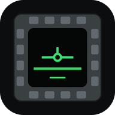

<p align="center"></p>

<h1 align="center">DCS Tablette</h1>

<p align="center">Les écrans du cockpit de DCS World sur une tablette ou un téléphone, avec leurs boutons sous le doigt.</p>

<p align="center">
<a href="https://github.com/led5014/dcs-tablette/releases/latest"></a>
<a href="https://github.com/led5014/dcs-tablette/releases"></a>
<a href="LICENSE"></a>
<a href="https://github.com/led5014/dcs-tablette/actions/workflows/tests.yml"></a>
<a href="https://led5014.github.io/dcs-tablette/"></a>
<a href="https://discord.gg/4KJYjt7pbc"></a>
</p>

<p align="center"><strong><a href="https://github.com/led5014/dcs-tablette/releases/latest">Télécharger la dernière version</a></strong> · <a href="https://led5014.github.io/dcs-tablette/">Site</a> · <a href="docs/guide.md">Guide complet</a> · <a href="README.en.md">English</a></p>

## Ce que ça fait

- **Écrans en direct** : DDI, MFD, MPD recopiés depuis DCS, avec les boutons
  de leur cadre. Un bouton reste enfoncé dans le cockpit tant que le doigt
  est posé.
- **Panneaux redessinés** : UFC, IFEI, instruments de secours et voyants du
  Hornet ; ICP et DED du F-16.
- **Instruments pour tout appareil** : badin, horizon, altimètre, virage et
  bille, cap, vario, G, régime, dans les unités du cockpit. De quoi garder la
  tête dehors, warbirds compris.
- **Kneeboard** : les pages de la mission, du module, de la carte et les
  vôtres, et le kneeboard de DCS en direct.
- **Réglages par écran** : luminosité, contraste, netteté, définition, filtres
  (niveaux auto, nuit, ambre…).
- **Tablette, téléphone ou PC** : la page suit l'appareil piloté et ne
  propose que les dispositions confortables au doigt sur l'écran utilisé.

Le serveur tourne sur le PC, la tablette s'y connecte par le Wi-Fi de la
maison. Pas de Python à installer, rien sur internet en vol.

## Ce qu'il faut

- Un PC Windows avec DCS World.
- Une tablette ou un téléphone sur le même Wi-Fi : iPad sous iPadOS 13 ou
  plus récent (iPad Air 2, iPad mini 4, iPad 5e génération et suivants),
  Android, ou le navigateur d'un autre PC.

## Installer

1. Télécharger `DCS-Tablette-x.y.z.zip` depuis la
   [dernière version](https://github.com/led5014/dcs-tablette/releases/latest).
2. L'extraire n'importe où, puis double-cliquer **`Installer.bat`**. Si
   Windows affiche « Windows a protégé votre ordinateur » : *Informations
   complémentaires* → *Exécuter quand même* (l'exécutable n'est pas signé ;
   il est construit à partir de ce dépôt).
3. Répondre aux questions de la fenêtre. Elle installe et place un écran
   virtuel, où DCS dessine les écrans du cockpit, installe les scripts dans
   DCS, règle DCS en fenêtré et pose un raccourci **DCS Tablette** sur le
   bureau. Si une étape n'aboutit pas, elle dit laquelle et quoi faire.

Chaque étape, ce qu'elle modifie et comment la faire à la main :
[guide, Installation](docs/guide.md#installation).

**Mettre à jour : rien à faire.** DCS Tablette se met à jour tout seul au
lancement (téléchargement vérifié, réglages gardés).
**Désinstaller** : *Paramètres → Applications → Applications installées →
DCS Tablette*.

## En vol

1. Lancer **DCS Tablette** (bureau ou menu Démarrer) : la fenêtre affiche
   l'adresse à ouvrir sur la tablette (`http://192.168.x.x:8320`). Au premier
   lancement, autoriser le programme sur le réseau **privé**.
2. Ouvrir l'adresse sur la tablette, puis l'ajouter à l'écran d'accueil
   (Safari : *Partager* → *Sur l'écran d'accueil* ; Chrome : ⋮ → *Ajouter à
   l'écran d'accueil*).
3. Lancer DCS et une mission : la page se construit pour l'appareil piloté.

## Appareils

| Appareil | Écrans + boutons | En plus |
|---|---|---|
| F/A-18C Hornet | DDI G, DDI D, AMPCD | UFC tactile, IFEI, secours, voyants |
| F-16C Viper | MFD G, MFD D | ICP tactile, DED |
| AH-64D Apache | MPD G, MPD D (+ FCR, WPN, TSD…), TEDAC en image | siège Pilote / CPG |
| OH-58D Kiowa | MFD G, MFD D | — |
| A-10C / A-10C II | MFCD G, MFCD D | — |
| AV-8B Harrier | MPCD G, MPCD D | — |
| F-15E Strike Eagle | MPD G, MPD D, MPCD (place avant) | — |
| JF-17 Thunder | MFCD G, centre, D (en portrait, 26 boutons) | — |
| Ka-50 Black Shark II / III | Shkval en image, ABRIS et ses 5 boutons | — |
| C-130J-30 Super Hercules | HDD G, centre, D en image (pages choisies sur les AMU du cockpit) | kneeboard |
| MiG-29A Fulcrum | HDD, la recopie du HUD (interrupteur TACT / DUBL) | HDD + instruments côte à côte, kneeboard |
| Warbirds : P-51D, TF-51D, P-47D, F4U-1D, Spitfire IX, Mosquito, Bf 109 K-4, Fw 190 A-8 / D-9, I-16, Yak-52 | — (cockpits à cadrans) | instruments dans leurs unités, kneeboard |
| Corée : F-86F, MiG-15bis | — | instruments, kneeboard |
| F-14, F-4E, Mirage 2000C, Mirage F1, F-5E, MiG-21bis, MiG-19P, AJS-37, L-39, C-101, MB-339, FC3 | — | instruments, kneeboard |
| CH-47F, Mi-8MTV2, Mi-24P, UH-1H, SA342 | — | instruments d'hélicoptère, kneeboard |

Tout autre appareil a les instruments de base et le kneeboard. Les boutons
du F-16C, de l'OH-58D, de l'AV-8B, du F-15E, du JF-17 et du Ka-50 restent à
confirmer en vol : un retour est bienvenu. Détails par appareil :
[guide, Appareils](docs/guide.md#appareils).

## Multijoueur

DCS Tablette n'écrit que dans `Saved Games\DCS`, jamais dans le dossier
d'installation de DCS : le contrôle d'intégrité du multijoueur n'est pas
concerné. Le script de la tablette dans DCS n'accepte que les commandes des
boutons affichés (une liste blanche par appareil) et relâche tout bouton
tenu plus de 5 secondes. Liste des fichiers touchés :
[guide, Ce que l'installation modifie](docs/guide.md#ce-que-linstallation-modifie).

## En cas de problème

D'abord le diagnostic : sur la tablette, toucher la pastille en haut à
gauche. Il dit ce qui manque et comment le régler, et répare seul ce qui se
répare sans risque.

- **La page ne s'ouvre pas sur la tablette** : passer le Wi-Fi du PC en
  réseau *Privé* dans Windows.
- **Écrans noirs** : relancer DCS après l'installation, et vérifier dans
  Options → Système → Moniteurs que « Tablette DCS » est choisi.
- **Un stream ou une capture montre deux écrans** : partager l'écran
  principal, pas la fenêtre de DCS ([guide, Captures et stream](docs/guide.md#captures-et-stream)).

Les autres cas : [guide, Problèmes courants](docs/guide.md#problèmes-courants).
Aide, idées, nouvelles versions : le Discord
**[L'atelier DCS OS](https://discord.gg/4KJYjt7pbc)**, gratuit, en français
(#aide, #idées, #annonces).

## Pour les développeurs

Python 3.12, Windows.

```bat
py -3.12 -m venv .venv
.venv\Scripts\pip install -r requirements.txt
set PYTHONPATH=src
.venv\Scripts\python.exe -m tablette installer
launch_tablette.bat
```

- **Lancer** : `launch_tablette.bat` (ou `python -m tablette` avec
  `PYTHONPATH=src`) ; `--local` n'écoute que ce PC, `--help` liste les
  options.
- **Tests** : `.venv\Scripts\python.exe -m unittest discover -s tests`, avec
  `PYTHONPATH=src`. Les tests qui relisent les scripts d'un module de DCS
  s'ignorent quand le module n'est pas installé.
- **Sans DCS** : `scripts\simuler_dcs_tablette.py [nom de l'appareil]` se
  fait passer pour le jeu et affiche chaque ordre reçu.
- **Construire le zip** : `.venv\Scripts\python.exe scripts\construire_tablette.py`.

Plan du code, dans `src/tablette/` :

- `app.py` : l'API et la page servies à la tablette (`web/`).
- `appareils/` : un profil par appareil, écrans, boutons et numéros de
  commande ; la liste blanche du script Lua en découle.
- `dcs.py` : le lien UDP avec le script Lua (`dcs_export/`), qui joue les
  appuis dans le cockpit et renvoie l'état de l'appareil.
- `video.py`, `capture.py` : la copie des écrans exportés depuis la fenêtre
  de DCS.
- `installation.py`, `ecran_virtuel.py`, `ecrans_dcs.py` : l'installation,
  l'écran virtuel et la configuration d'écrans de DCS.
- `diagnostic.py` : les vérifications et les réparations.
- `langues.py`, `anglais.py` : le français dans le code, l'anglais à la
  demande.

Fonctionnement détaillé, choix et pistes écartées :
[docs/tablette.md](docs/tablette.md). Le site est dans `site/`, publié par
`.github/workflows/pages.yml`.

---

Gratuit et open source, sous [licence MIT](LICENSE) : libre d'utiliser, de
modifier et de redistribuer, en gardant la mention de licence.

Outil communautaire, sans lien avec Eagle Dynamics. DCS World est une marque
d'Eagle Dynamics SA.
